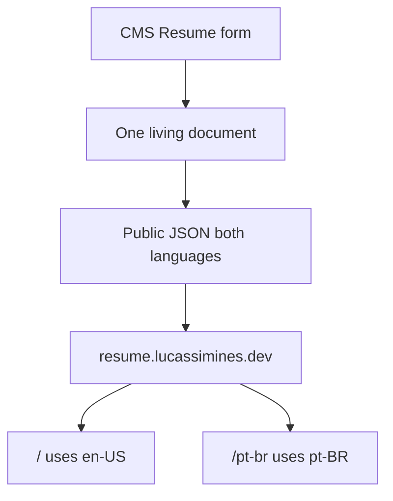
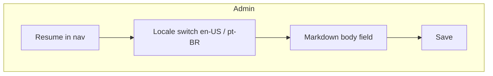

# Resume CMS Document - Plan

## Goal Capsule

- **Objective:** Give the site owner a Resume section in the CMS to edit en-US and pt-BR markdown in a normal CMS form, and expose one public JSON with both languages so resume.lucassimines.dev can stop reading `.md` files.
- **Product authority:** This plan owns the CMS Resume document and the public JSON that replaces `content.md`. Wiring the fetch and language switcher on resume.lucassimines.dev is not active scope.
- **Open blockers:** None.

---

## Product Contract

### Summary

A dedicated Resume section in the CMS holds one living document with en-US and pt-BR markdown.
Saving that form immediately updates a public JSON payload that contains both languages.
resume.lucassimines.dev fetches that JSON once, uses en-US on `/`, and uses pt-BR on `/pt-br`.

### Problem Frame

Resume copy today lives in `content.md` in the resume site repo.
Updating it means editing a file, committing, and redeploying.
The English site is live; `/pt-br` is not.
The CMS already has bilingual forms and a settings `resumeUrl` (a link, not the document).
There is no Resume document and no public resume body to fetch.

### Key Decisions

- Dedicated Resume section, not Settings and not a Post-style list. (session-settled: user-approved — chosen over Settings or Post list: this is one living document, not a profile URL or a collection) Governs R1, R2.
- Both locales in the CMS. (session-settled: user-directed — chosen over a single English document: the resume site has `/` and `/pt-br`) Governs R3, R8.
- One public JSON with both languages. (session-settled: user-directed — chosen over fetch-by-locale: the site picks language from the URL) Governs R6, R7, R8.
- Save is live. (session-settled: user-directed — chosen over draft/publish: no publish gate) Governs R5, R9.
- CMS form chrome, not a special markdown editor. (session-settled: user-directed — chosen over a split-pane markdown IDE: follow existing CMS forms; `.md` files go away) Governs R2, R4.
- Body stays markdown text. (session-settled: user-approved — chosen over HTML like posts: files go away, format stays so the resume site can keep rendering markdown) Governs R4.

### Requirements

**Admin**

- R1. The admin has a Resume section in the same navigation as other content entities.
- R2. Resume is one living document opened as a CMS form (locale switch, fields, save), not a list of resumes.
- R3. The form lets the operator edit en-US and pt-BR independently using the CMS locale pattern.
- R4. Each locale's body is markdown source text, not HTML.
- R5. Saving the form is the publish step: the public JSON updates immediately.

**Public JSON**

- R6. An unauthenticated public read returns one JSON payload that includes both en-US and pt-BR markdown.
- R7. That payload is enough for resume.lucassimines.dev to render either locale without a second request.
- R8. Both language keys are always present; a locale with no copy is an empty string, not omitted.
- R9. There is no draft or unpublished state for Resume; whatever is saved is what the public read returns.

**Existing settings**

- R10. Settings `resumeUrl` stays a URL to the hosted resume; it does not store the resume body.

### Actors

- A1. **Site owner** — edits the Resume form in the CMS and expects save to go live.
- A2. **resume.lucassimines.dev** — fetches the public JSON and selects a language from the URL.
- A3. **Resume visitor** — sees en-US at `/` or pt-BR at `/pt-br`; does not use the CMS.

### Key Flows

- F1. Owner updates the live resume
  - **Trigger:** A1 opens Resume in the admin.
  - **Actors:** A1
  - **Steps:** Switch locale as needed; edit markdown; save. Public JSON now contains the new text for that locale and the current text (or empty string) for the other.
  - **Outcome:** A2 can read both languages without a CMS login.
  - **Covered by:** R1, R2, R3, R4, R5, R6, R8, R9

- F2. Resume site renders a locale from one fetch
  - **Trigger:** A3 opens `/` or `/pt-br`.
  - **Actors:** A2, A3
  - **Steps:** A2 fetches the public JSON once; `/` uses the en-US markdown; `/pt-br` uses the pt-BR markdown; a language switcher moves between those URLs.
  - **Outcome:** No `.md` file is required at request time. A2 implements this flow later; this plan only requires the JSON to support it.
  - **Covered by:** R6, R7, R8

### Acceptance Examples

- AE1. Save English only
  - **Covers R5, R8, R9.**
  - **Given:** pt-BR body is empty and en-US has markdown.
  - **When:** A1 saves.
  - **Then:** The public JSON includes both keys; en-US has the saved markdown; pt-BR is an empty string.

- AE2. Update one locale without clobbering the other
  - **Covers R3, R5, R6.**
  - **Given:** both locales have markdown.
  - **When:** A1 changes only pt-BR and saves.
  - **Then:** The public JSON shows the new pt-BR and the previous en-US.

- AE3. Site language from one payload
  - **Covers R6, R7.**
  - **Given:** the public JSON has both languages.
  - **When:** A2 fetches once.
  - **Then:** `/` can render en-US and `/pt-br` can render pt-BR with no extra fetch.

- AE4. Anonymous public read
  - **Covers R6, R9.**
  - **Given:** A1 has saved the form.
  - **When:** anyone requests the public JSON without auth.
  - **Then:** the response is the saved document, not a login error and not a stale pre-save body.

### Scope Boundaries

**Deferred for later**

- Wiring resume.lucassimines.dev to fetch this JSON and drive `/` vs `/pt-br`.
- Seeding or migrating today's English `content.md` into the CMS (the owner can paste it).

**Not this work**

- A list of resume versions or per-job variants.
- Draft/publish, preview, or a split-pane markdown IDE.
- Storing the resume body as HTML like posts.
- Putting the resume body on Settings next to `resumeUrl`.
- Changing how posts, pages, or other entities are edited.

<!-- ce-section: work-relationships -->
### How This Work Fits Together

This plan owns the CMS Resume document and the public JSON that replaces `content.md`.
The broader split below is the current understanding, not a committed roadmap.

- **Resume site consumption** (`resume.lucassimines.dev`)
  - Depends on the public JSON in this plan.
  - Can proceed independently of CMS admin polish once the JSON contract exists.
  - Still to decide: how that repo fetches, caches, and maps `/` vs `/pt-br`.

### Dependencies / Assumptions

- The CMS locale pair remains en-US and pt-BR.
- Resume admin UI reuses existing CMS form patterns (locale switch, save), not a new editor product.
- Settings already has `resumeUrl` as a localized URL; that field stays a link (R10).
- The public web API already serves unauthenticated published content; Resume follows that anonymous-read pattern with no extra publish flag (R6, R9).
- A2 is a separate codebase; this plan only guarantees the JSON is fetchable and bilingual.
- Empty pt-BR is acceptable on day one; the live `/pt-br` URL is currently missing.

### Outstanding Questions

**Deferred to Planning**

- How the singleton document is stored and updated (one row vs keyed setting), as long as the admin feels like one form (R2).
- Exact public JSON field names and wrapper shape, as long as both language bodies are present (R6, R8).
- Which existing CMS field control renders the markdown body, as long as it is source text with locale switching (R3, R4).
- Cache invalidation for the public JSON after save.

### Sources / Research

- No Resume model or public resume body exists today; admin entities are page, post, category, project, technology, solution, settings (`admin/app/types/entity.ts`).
- Settings profile already has localized `resumeUrl` (`admin/app/types/settings.ts`).
- Long-form admin editing is HTML (`admin/app/components/field/FieldEditor.vue`); localized textarea exists (`admin/app/components/field/FieldTextarea.vue`).
- Public web routes today: bootstrap, pages, posts, projects, sitemap (`server/src/web/routes/index.ts`).
- Live https://resume.lucassimines.dev/ serves the English resume; https://resume.lucassimines.dev/pt-br returned 404 at capture time.
